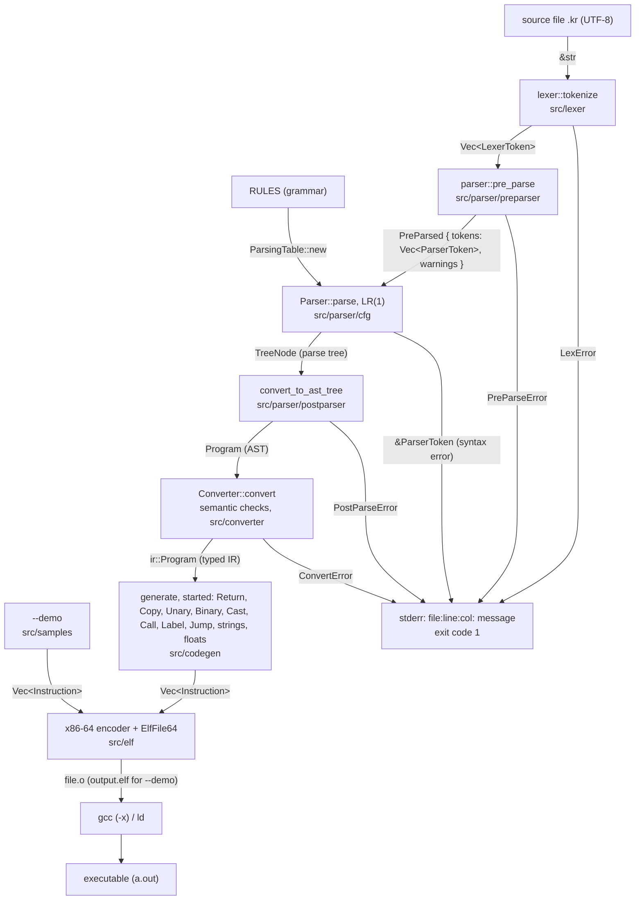

# Krc: a Korean programming language and its compiler

[](https://github.com/Solype/Krc/actions/workflows/ci.yml)
[](LICENSE.md)

**Krc** is a programming language written in Korean (한국어 프로그래밍 언어), with a compiler in
Rust that produces x86-64 Linux ELF object files. Originally made for the Compiler class of CAU
(Chung-Ang University), now continued for fun.

```
두 정수 가와 나를 받아 나누고 정수를 반환 {
    나머지는 정수예요.
    (나 == 0)이 아닌 동안 {
        나머지에 (가 % 나)를 넣어요.
        가에 나를 넣어요.
        나에 나머지를 넣어요.
    }
    가를 반환해요.
}
```

This is the greatest common divisor, from [`sample/10_gcd.kr`](sample/10_gcd.kr).

## About
This project is a compiler written in Rust, originally developed as part of the Compiler course at
CAU. Its source language is Korean: functions are verbs, arguments carry their particles
(`3과 4를 더해서 제곱해서 반환해요`), and the libc is called as latin name + `하다`
(`"%ld\n"과 가를 printf해요`). The design of the language is in `docs/LANGUAGE_DESIGN.md`.
The target is an x86-64 ELF object file (`.o` equivalent), linked with `ld` or `gcc`.

## Current State
⚠️ This project is a work in progress.

- **Front-end, done**: the lexer, the pre-parser (particles and conjugated verbs), the LR(1)
  parser and the AST read every program of `sample/` and `Proto.kr`.
- **Semantic analysis (`src/converter`), mostly done**: scopes, types, overloads, returns,
  constants, loops. Each error is printed as `file:line:col: message`.
- **Back-end**: the x86-64 encoder and the ELF writer (sections, symbols, relocations) work.
- **Code generation (`src/codegen`), started**: each `file.kr` gives a `file.o`, linked with
  `gcc` by `-x`. Generated today: the stack frame, `return`, copies, `+ - * / % & | ^ << >>`,
  `-x`, `~x`, `!x`, calls with integer, string and float arguments (System V, so `printf`
  works), strings and float constants in `.rodata`, `소수` and `짧은 소수` (SSE: `addsd`,
  `addss`, …, arguments and result in `xmm`), `바꾸다` (`cvtsi2sd`, `cvttsd2si`, `movsxd`, …),
  `mov` sized by the variable (4-byte `짧은 정수`), comparisons (`cmp` / `ucomisd`, then
  `setcc`), labels and jumps (`jmp`, `je` for `JumpIfNot`), so `만약` / `아니면`, `동안`,
  `세면서`, `그만해요`, `넘어가요`, and `그리고` / `또는` in short-circuit. Every `sample/*.kr`
  runs.
- **Tests of the samples**: `scripts/run_samples.sh [file.kr...]` compiles, links and runs each
  `sample/*.kr`, compares its exit code (and its stdout with `sample/*.out`) with the expected
  one, and checks that each `sample/errors/*.kr` is refused with code 1.
- The demo (`--demo`) writes the encoder test programs hardcoded in `src/samples/`.

## How it works
1. The source is cut into tokens (`src/lexer`), then the pre-parser splits the particles and
   recognizes the keywords, types and verbs (`src/parser/preparser`).
2. The LR(1) parser builds the parse tree from the grammar (`src/parser/cfg`), turned into an AST
   (`src/parser/postparser`).
3. The converter checks the AST: names, types, calls, returns (`src/converter`).
4. *(started)* The code generation turns the IR into `Instruction` enum variants (`src/codegen`).
5. The instructions are encoded into machine code and written into an ELF object file
   (`src/elf`), linked with standard tools (`ld`, `gcc`) into a runnable binary.

## Pipeline (current state)
Solid arrows: what runs today. Dotted arrows: still to be written. Each edge carries the data
type passed from one stage to the next.



| Type | Defined in |
|---|---|
| `LexerToken`, `LexError` | `src/lexer/lexer_token.rs`, `src/lexer/lexer_error.rs` |
| `PreParsed`, `PreParseError`, `PreParseWarning` | `src/parser/preparser/` |
| `ParserToken` | `src/parser/parser_token.rs` |
| `TreeNode`, `Parser` | `src/parser/cfg/parser.rs` |
| `Program`, `Function`, `Statement`, `Expr`, `Type` (AST), `PostParseError` | `src/parser/postparser/` |
| `ConvertError` | `src/converter/convert_error.rs` |
| `Instruction` | `src/elf/instructions/` |
| `ElfFile64` | `src/elf/file/` |

## Usage
```bash
cargo build --release
./target/release/compiler [--tree] [-x] <file.kr>...   # each file.kr gives file.o
./target/release/compiler --demo                       # write the demo ELF: output.elf
```

- Each `file.kr` is compiled to `file.o`, next to the source; its AST and IR are printed.
- `-x` links all the `.o` with `gcc` into `a.out`.
- `--tree` also prints the parse tree, before the AST.
- Any error (source, unreadable file, usage, `gcc`) exits with code 1.
- Sample programs are in `sample/` (`01_return.kr` to `15_floats.kr`), programs that must be
  refused in `sample/errors/`, and the reference program is `Proto.kr`.

The demo calls an external `my_exit`, to provide at link time, for example with NASM:

```nasm
BITS 64
global my_exit
section .text
my_exit:
    mov rax, 60
    mov rdi, 100
    syscall
```

```bash
nasm -f elf64 my_exit.asm -o my_exit.o
ld -o output output.elf my_exit.o
./output; echo $?   # 42
```

Tests: `cargo test`, then `scripts/run_samples.sh`. `scripts/analyze.sh file.o` prints the
symbols and the disassembly of an object file.

## Repository layout
| Path | Content |
|---|---|
| `src/` | The compiler, one folder per stage (see [How it works](#how-it-works)) |
| `elf_derive/` | Derive macro that writes the ELF structures |
| `sample/` | Programs that must run (`NN_*.kr`, expected stdout in `NN_*.out`) and programs that must be refused (`errors/`) |
| `Proto.kr` | Reference program, expected values in its comments |
| `scripts/` | `run_samples.sh` (sample tests), `analyze.sh` (`nm` + `objdump` of a `.o`) |
| `docs/` | Language design (`LANGUAGE_DESIGN.md`), encoder test report, LR(1) table example |
| `editors/` | Syntax highlighting for Zed, micro and tree-sitter |
| `USE_OF_AI.md` | What was written with AI, and how |

## Roadmap
What is left is tracked in the [GitHub issues](https://github.com/Solype/Krc/issues),
labelled by stage: `front-end`, `converter`, `codegen`, `backend`, `tooling`, and `later` for
what the compiler does not need.

## Context
This project started during my second semester studying in Korea, as part of the Compiler class at CAU, with the goal of exploring how a compiler translates source-level instructions down into machine code and executable binaries. The class is over, and I keep working on it for fun.

## Contributing and license
See [`CONTRIBUTING.md`](CONTRIBUTING.md) to take part. The project is under the MIT license, see
[`LICENSE.md`](LICENSE.md).
