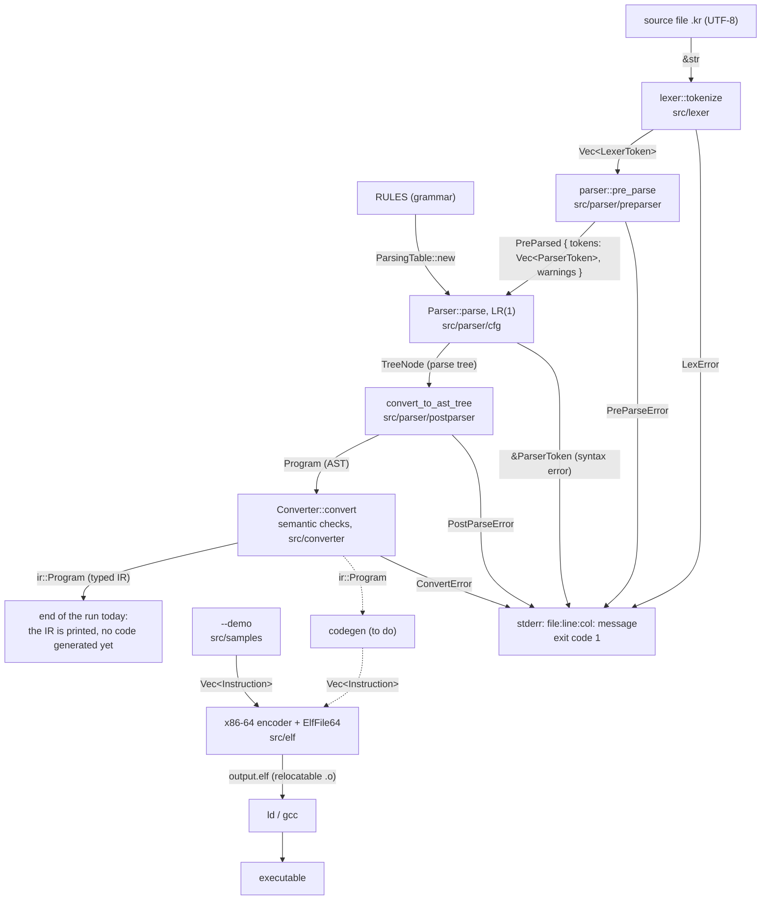

# CompilerRust
Compiler made in Rust for the Compiler class of CAU (Chung-Ang University).

## About
This project is a compiler written in Rust, developed as part of the Compiler course at CAU. Its
source language is Korean: functions are verbs, arguments carry their particles
(`3과 4를 더해서 제곱해서 반환해요`), and the libc is called as latin name + `하다`
(`"%ld\n"과 가를 printf해요`). The design of the language is in `LANGUAGE_DESIGN.md` (French).
The target is an x86-64 ELF object file (`.o` equivalent), linked with `ld` or `gcc`.

## Current State
⚠️ This project is a work in progress.

- **Front-end, done**: the lexer, the pre-parser (particles and conjugated verbs), the LR(1)
  parser and the AST read every program of `sample/` and `Proto.kr`.
- **Semantic analysis (`src/converter`), mostly done**: scopes, types, overloads, returns,
  constants, loops. Each error is printed as `file:line:col: message`.
- **Back-end, done apart from the code generation**: the x86-64 encoder and the ELF writer
  (sections, symbols, relocations) work, but nothing turns the AST into instructions yet.
  Compiling a `.kr` file stops after the checks: it prints the AST as pseudo-code, then the IR,
  and writes no binary.
- The only ELF written today is the demo (`--demo`): the encoder test programs hardcoded in
  `src/samples/`.

## How it works
1. The source is cut into tokens (`src/lexer`), then the pre-parser splits the particles and
   recognizes the keywords, types and verbs (`src/parser/preparser`).
2. The LR(1) parser builds the parse tree from the grammar (`src/parser/cfg`), turned into an AST
   (`src/parser/postparser`).
3. The converter checks the AST: names, types, calls, returns (`src/converter`).
4. *(to do)* The code generation turns the checked program into `Instruction` enum variants.
5. The instructions are encoded into machine code and written into an ELF object file
   (`src/elf`), linked with standard tools (`ld`, `gcc`) into a runnable binary.

## Pipeline (current state)
Solid arrows: what runs today. Dotted arrows: still to be written. Each edge carries the data
type passed from one stage to the next.



| Type | Defined in |
|---|---|
| `LexerToken`, `LexError` | `src/lexer/lexer_token.rs`, `src/lexer/lexer_error.rs` |
| `PreParsed`, `PreParseError`, `PreParseWarning` | `src/parser/preparser/` |
| `ParserToken` | `src/parser/parser_token.rs` |
| `TreeNode`, `Parser` | `src/parser/cfg/parser.rs` |
| `Program`, `Function`, `Statement`, `Expr`, `Type` (AST), `PostParseError` | `src/parser/postparser/` |
| `ConvertError` | `src/converter/convert_error.rs` |
| `Instruction` | `src/elf/instructions/` |
| `ElfFile64` | `src/elf/file/` |

## Usage
```bash
cargo build --release
./target/release/compiler [--tree] <file.kr>   # check a program, print its AST
./target/release/compiler --demo               # write the demo ELF: output.elf
```

- `--tree` also prints the parse tree, before the AST.
- An error in the source exits with code 1, an unreadable file with code 84.
- Sample programs are in `sample/` (`01_retour.kr` to `11_affectation.kr`), programs that must be
  refused in `sample/erreurs/`, and the reference program is `Proto.kr`.

The demo calls an external `my_exit`, to provide at link time, for example with NASM:

```nasm
BITS 64
global my_exit
section .text
my_exit:
    mov rax, 60
    mov rdi, 100
    syscall
```

```bash
nasm -f elf64 my_exit.asm -o my_exit.o
ld -o output output.elf my_exit.o
./output; echo $?   # 42
```

Tests: `cargo test`.

## Roadmap
- [ ] Finish all instructions (currently on x86-64 instructions on SIMD registers)
- [x] Add a proper lexer/tokenizer for source input
- [x] Add a parser to build an AST
- [x] Support command-line arguments (input file, options)
- [ ] Semantic analysis: finish the checks (literal ranges, casts, `외부` parameters), then
  produce a typed IR for the code generation
- [ ] Replace hardcoded instruction enums with dynamic instruction generation (code generation)
- [ ] Write the program to an ELF object file and link it with the libc (`gcc file.o`)
- [ ] Expand instruction set coverage

## Context
This project was built during my second semester studying in Korea, as part of the Compiler class at CAU, with the goal of exploring how a compiler translates source-level instructions down into machine code and executable binaries.
